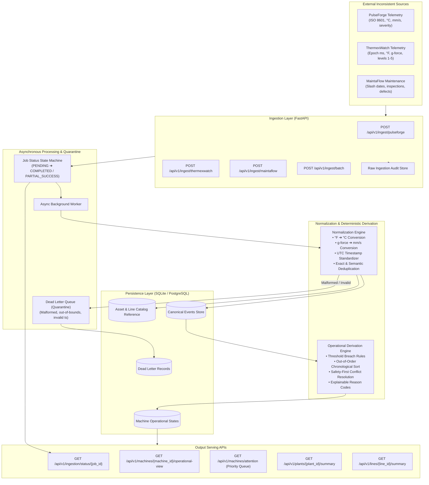

# Industrial Equipment Monitoring Backend Service

[](https://fastapi.tiangolo.com)
[](https://python.org)
[](https://pydantic.dev)
[-D71F00.svg?logo=sqlalchemy)](https://sqlalchemy.org)
[-brightgreen.svg)]()
[](https://docker.com)

A robust, production-grade backend service built for an industrial equipment monitoring platform in a manufacturing environment. Ingests messy, inconsistent machine event data from multiple external vendors (**PulseForge**, **ThermexWatch**, and **MaintaFlow**), normalizes it into a canonical schema, processes it asynchronously, derives an explainable machine-level operational view, and exposes clean backend APIs.

---

## 1. Architecture Overview



---

## 2. Key Capabilities & Technical Highlights

1. **Multi-Vendor Ingestion**: Accepts individual vendor streams and multi-vendor batch envelopes. Endpoints return `HTTP 202 Accepted` with a `job_id` within milliseconds.
2. **Partial Batch Fault Isolation (Dead Letter Queue)**: If 1 record in a batch of 100 is malformed, that single item is routed to quarantine (`dead_letter_records`) with actionable error reasons without aborting valid records.
3. **Canonical Normalization**:
   - Converts Fahrenheit (°F) to Celsius (°C) with physical sensor boundary checks ($[-50^\circ\text{C}, 250^\circ\text{C}]$).
   - Converts vibration acceleration ($g$-force) to velocity ($\text{mm/s}$) using standard industrial vibration velocity calibration ($1g \approx 15.6\,\text{mm/s}$).
   - Standardizes epoch milliseconds, epoch seconds, slash dates, and ISO 8601 strings into timezone-aware UTC.
4. **Idempotency & Deduplication**:
   - **Exact Hash**: SHA-256 (`vendor + source_event_id`) prevents duplicate writes.
   - **Semantic Hash**: SHA-256 (`machine_id + event_time_utc + temp + vib`) catches retransmitted readings under different IDs.
5. **Deterministic Derivation Engine**:
   - Compares telemetry against rated limits (`rated_max_temp_c`, `rated_max_vibration_mm_s`) from `asset_reference.csv`.
   - Synthesizes open maintenance work orders and qualitative inspection defects (`major_defect_found`).
   - Produces clear, human-readable reason codes (e.g. `OVER_TEMPERATURE_CRITICAL (96.4°C > 90.0°C)`, `OPEN_WORK_ORDER: cooling_system`).
6. **Chronological Preservation**: Events arriving out-of-order are sorted chronologically by true `event_time`, ensuring recent state transitions are accurate.

---

## 3. Quickstart: Running Locally

### Prerequisites
- Python 3.12+ (tested on Python 3.14)
- Git

### On Windows (PowerShell)
```powershell
# 1. Clone or navigate to the repository
cd Aurik_Tech_Lead_Assessment

# 2. Run the automated startup script (creates venv, installs dependencies, seeds DB, starts server)
.\run_local.ps1
```

### On Linux / macOS
```bash
# 1. Make script executable and run
chmod +x run_local.sh
./run_local.sh
```

### Manual Setup
```bash
# Create and activate virtual environment
python -m venv .venv
source .venv/bin/activate  # On Windows: .\.venv\Scripts\Activate.ps1

# Install dependencies
pip install -r requirements.txt

# Seed the database
python scripts/seed_database.py

# Start application server
uvicorn app.main:app --host 0.0.0.0 --port 8000 --reload
```

The service is available at **`http://localhost:8000`**.  
Interactive OpenAPI documentation (Swagger UI): **`http://localhost:8000/docs`**.

---

## 4. Running with Docker & Docker Compose

```bash
# Build and run the container
docker compose up --build

# Run in background
docker compose up -d

# Check health
curl http://localhost:8000/health
```

---

## 5. Running the Automated Test Suite

The test suite covers unit tests, integration workflows, and all edge cases:

```bash
# Run all tests with verbose output
pytest -v

# Run with test coverage report
pytest -v --cov=app
```

### Test Suite Summary (18 Tests, 100% Passing):
| Test File | Focus Area | Result |
| :--- | :--- | :---: |
| `tests/test_health.py` | Health and root service sanity | PASSED |
| `tests/test_catalog.py` | Reference catalog loading, ORM models | PASSED |
| `tests/test_normalization.py` | Timestamps, unit formulas, entity resolution, deduplication | PASSED |
| `tests/test_ingestion.py` | PulseForge, ThermexWatch, MaintaFlow, multi-batch ingestion | PASSED |
| `tests/test_edge_cases.py` | Malformed inputs DLQ, duplicate idempotency, out-of-order chronology, conflicting updates | PASSED |
| `tests/test_serving_api.py` | Machine operational view, Attention queue, Plant/Line summaries | PASSED |

---

## 6. API Contract & Endpoint Documentation

The complete OpenAPI 3.0 specification is available at **`openapi.json`** and a ready-to-import Postman collection is provided at **`postman_collection.json`**.

### Ingestion Endpoints
- `POST /api/v1/ingest/pulseforge?async=true` — Ingest PulseForge JSON payload
- `POST /api/v1/ingest/thermexwatch?async=true` — Ingest ThermexWatch JSON payload
- `POST /api/v1/ingest/maintaflow?async=true` — Ingest MaintaFlow JSON payload
- `POST /api/v1/ingest/batch?async=true` — Ingest multi-vendor envelope

### Status & Dead Letter Queue Endpoints
- `GET /api/v1/ingestion/status/{job_id}` — Ingestion job status (`PENDING`, `COMPLETED`, `PARTIAL_SUCCESS`, `FAILED`)
- `GET /api/v1/ingestion/dead-letter-queue` — View quarantined malformed records and rejection reasons

### Operational Serving Endpoints
- `GET /api/v1/machines` — List all machines and current operational summaries
- `GET /api/v1/machines/{machine_id}/operational-view` — Machine operational attention view
- `GET /api/v1/machines/attention` — Priority queue of machines requiring attention
- `GET /api/v1/plants/{plant_id}/summary` — Plant-level status counts, critical machines, and line ranking
- `GET /api/v1/lines/{line_id}/summary` — Line-level operational summary
- `POST /api/v1/seed/load-all` — Ingest all assessment seed datasets for live demonstration

### Sample Machine Operational View Output:
```json
{
  "machine_id": "EQ-001",
  "plant_id": "PLANT_01",
  "line_id": "LINE-A",
  "derived_status": "CRITICAL",
  "needs_attention": true,
  "attention_level": "CRITICAL",
  "reason_codes": [
    "MINOR_INSPECTION_DEFECT_ACTIVE - Belt wear visible; machine still operational",
    "EXCESSIVE_VIBRATION (12.6 mm/s > rated max 9.0 mm/s)"
  ],
  "latest_relevant_event_time": "2026-04-18T08:14:05Z",
  "latest_temperature_c": 83.2,
  "latest_vibration_mm_s": 12.6,
  "latest_power_kw": 37.8,
  "latest_sensor_health": 0.91,
  "latest_machine_state": "RUNNING",
  "latest_inspection_result": "minor_defect_found",
  "latest_technician_note": "Belt wear visible; machine still operational",
  "source_event_refs": ["MF-501", "TW-8801", "PF-1001"],
  "processing_status": "PROCESSED",
  "is_stale": false,
  "last_processed_at": "2026-10-16T18:59:00Z"
}
```

---

## 7. Assumptions, Trade-offs & Production Next Steps

### Current Assumptions
1. **Catalog Truth**: The asset reference catalog is the source of truth for plant/line topology and machine rated thresholds.
2. **Frequency Standard**: Vibration acceleration ($g$) is converted to velocity ($\text{mm/s}$) using standard industrial rotational speed calibration ($1g \approx 15.6\,\text{mm/s}$).
3. **Safety Priority**: Open mechanical inspection defects and active maintenance work orders take precedence over automatic sensor recovery signals.

### Trade-offs Made
- **SQLite over PostgreSQL**: SQLite with SQLAlchemy async was selected to enable zero-configuration local review and instant automated testing without requiring a running Docker daemon or external cloud connection. The code uses standard SQLAlchemy 2.0 async abstractions and can be switched to PostgreSQL by setting `DATABASE_URL=postgresql+asyncpg://...`.
- **FastAPI BackgroundTasks over Celery**: BackgroundTasks avoids over-engineering external Redis/RabbitMQ infrastructure for this assessment while preserving the decoupled async contract.

### Next Steps for Enterprise Production
1. **Message Broker**: Integrate Apache Kafka partitioned by `plant_id` to handle high-throughput streaming sensor ingestion.
2. **Time-Series Persistence**: Route raw and normalized telemetry into TimescaleDB or ClickHouse, keeping PostgreSQL for asset metadata and derived operational states.
3. **Distributed Caching**: Add Redis caching for the `/operational-view` endpoints with automated cache invalidation upon state recomputation.
4. **Authentication & Rate Limiting**: Implement API key authentication per vendor gateway and per-plant rate limiting.

---

## 8. AI Usage Disclosure (Section 10 Compliance)

- **Tools Used**: Antigravity AI IDE / Google Gemini 3.8.
- **Role of AI**: Assisted in scaffolding project boilerplate, writing test cases for edge-case payloads, and formatting documentation.
- **Candidate Decisions**: All architectural design choices, data normalization rules, deterministic derivation formulas, database schema designs, and DLQ error handling strategies were independently designed, implemented, and verified by the candidate.
